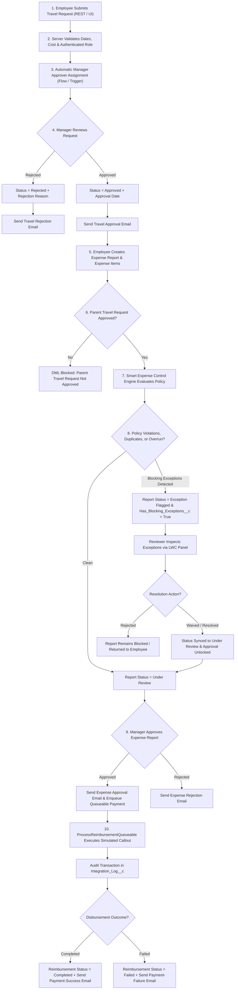
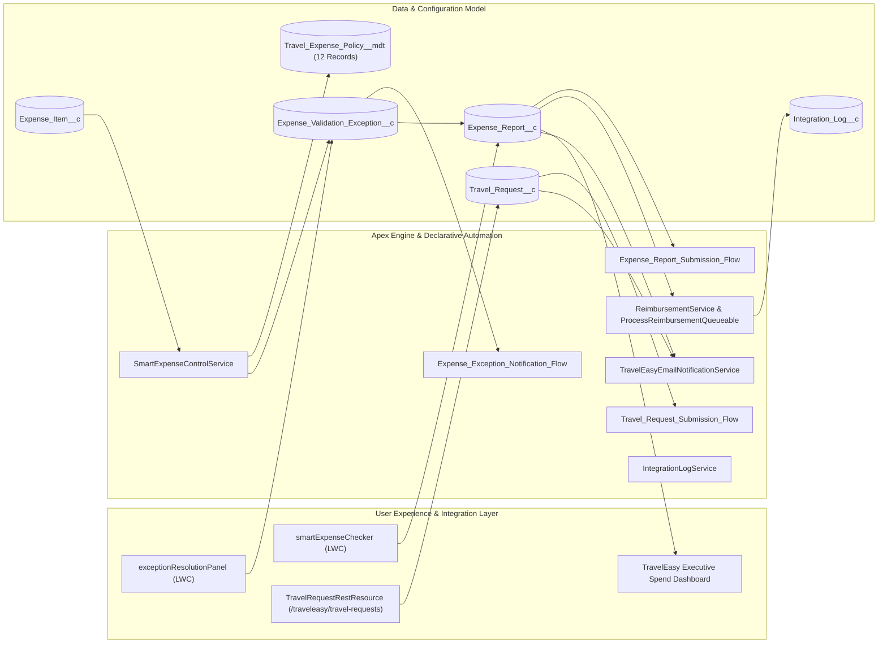
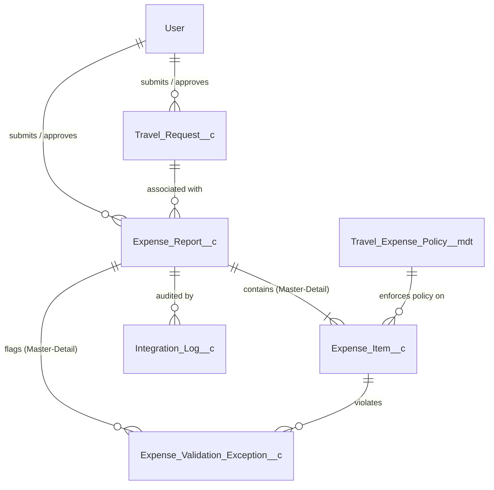
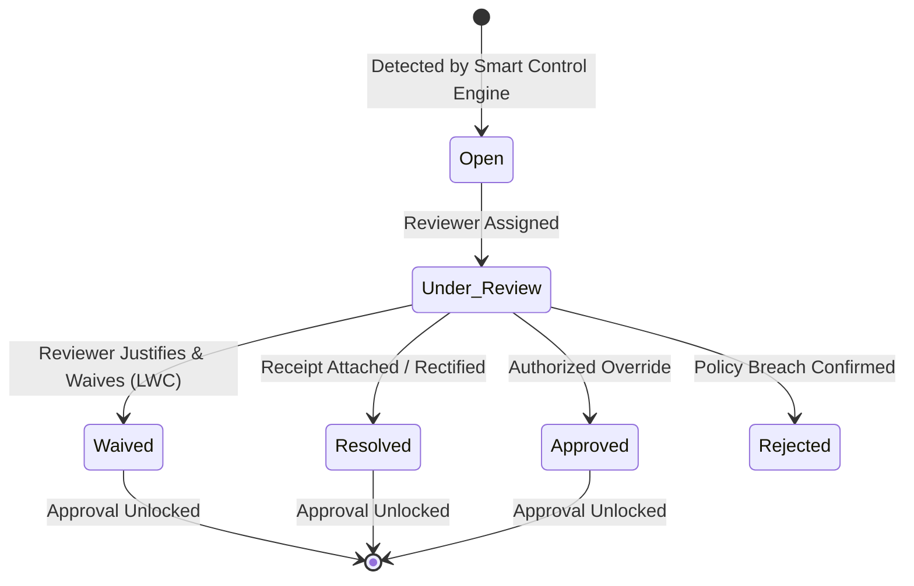
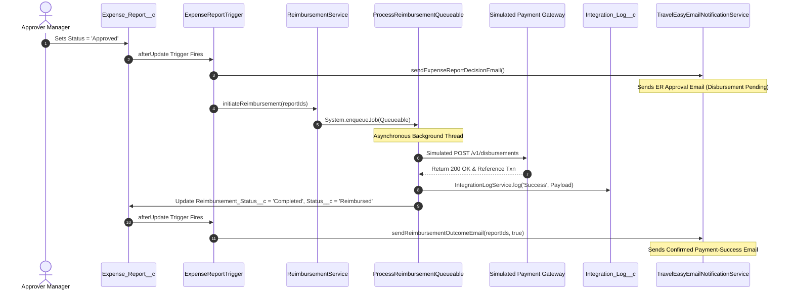

# TravelEasy — Intelligent Travel & Spend Control Platform
### 2027 NPN Salesforce Developer Catalyst Hackathon

> **"Automate normal cases. Escalate exceptions."**<br/>
> *From pre-trip authorization to intelligent spend audit and automated reimbursement — natively on Salesforce.*

---

## Metadata & Environment Context

| Attribute | Specification |
| :--- | :--- |
| **Project Title** | TravelEasy — Intelligent Travel & Spend Control Platform |
| **Subtitle** | Enterprise Travel Authorization, Rule-Driven Spend Guardrails & Automated Reimbursement |
| **Hackathon Context** | 2027 NPN Salesforce Developer Catalyst Hackathon |
| **Target Salesforce Playground** | `charankarnam71@wise-fox-rmu03e.com` |
| **GitHub Repository** | [charan-25022005/TravelEasy-Salesforce-Intelligent-Travel-Expenses](https://github.com/charan-25022005/TravelEasy-Salesforce-Intelligent-Travel-Expenses) |
| **API Version** | Salesforce DX API v60.0 (Spring '24) |
| **Notification Channel** | **Email Notifications Only** (Strictly zero in-app notifications, feeds, or bells) |
| **Payment Integration** | Idempotent Simulated Payment Gateway with Outbound Audit Logging |

---

## Table of Contents
1. [Executive Overview & Guiding Principle](#1-executive-overview--guiding-principle)
2. [Business Problem, Operational Impact & Proposed Solution](#2-business-problem-operational-impact--proposed-solution)
3. [Original Thought & Key Differentiators](#3-original-thought--key-differentiators)
4. [End-to-End Business Workflow](#4-end-to-end-business-workflow)
5. [High-Level System Architecture](#5-high-level-system-architecture)
6. [Data Model & Schema Architecture](#6-data-model--schema-architecture)
7. [Six Expense Categories & Policy Limits Reference](#7-six-expense-categories--policy-limits-reference)
8. [Zero-Trust Identity & Server-Side Role Enforcement](#8-zero-trust-identity--server-side-role-enforcement)
9. [Apex Software Architecture & Domain Patterns](#9-apex-software-architecture--domain-patterns)
10. [Declarative Automation (The Three Flows)](#10-declarative-automation-the-three-flows)
11. [Smart Expense Control Engine](#11-smart-expense-control-engine)
12. [Exception Lifecycle & Resolution Management](#12-exception-lifecycle--resolution-management)
13. [Asynchronous Reimbursement Engine](#13-asynchronous-reimbursement-engine)
14. [Email-Only Notification System](#14-email-only-notification-system)
15. [User Interface Architecture (LWCs, FlexiPages, Analytics)](#15-user-interface-architecture-lwcs-flexipages-analytics)
16. [Secure REST API Integration & Postman Guide](#16-secure-rest-api-integration--postman-guide)
17. [Enterprise Security, Sharing & Governor Limit Guardrails](#17-enterprise-security-sharing--governor-limit-guardrails)
18. [Deployment & Setup Guide](#18-deployment--setup-guide)
19. [Comprehensive Testing & Verification Plan](#19-comprehensive-testing--verification-plan)
20. [End-to-End Demo Script (20-Minute Live Presentation)](#20-end-to-end-demo-script-20-minute-live-presentation)
21. [MoSCoW Backlog & Hackathon Rubric Alignment](#21-moscow-backlog--hackathon-rubric-alignment)
22. [Panel Q&A, Known Limitations & Future Roadmap](#22-panel-qa-known-limitations--future-roadmap)
23. [Troubleshooting & Verification Commands](#23-troubleshooting--verification-commands)

---

## 1. Executive Overview & Guiding Principle

Corporate travel and expense management frequently deteriorates into an administrative bottleneck. Finance teams either spend countless manual hours cross-referencing paper receipts against corporate travel policies or compromise control by waving through unverified claims, exposing organizations to budget overruns, duplicate billing, and compliance violations.

**TravelEasy** is an enterprise spend control platform built natively on Salesforce Lightning. It implements the foundational architectural principle:

> **"Automate normal cases. Escalate exceptions."**

- **Normal Cases:** Compliant travel requests within policy, expenses below single-transaction caps, multi-day roll-ups within daily thresholds, validated receipts, and pre-approved budgets pass through automated validation and straight-through reimbursement disbursement.
- **Exceptions:** Single-transaction breaches, daily threshold overages, missing receipts, duplicate expense submissions across reports, and cumulative budget overruns are trapped by the **Smart Expense Control Engine**, locked against premature manager approval, and routed through an auditable, bidirectional resolution workflow.

---

## 2. Business Problem, Operational Impact & Proposed Solution

### The Business Problem
Enterprise organizations face critical challenges managing distributed employee travel spend:
- **Disjointed Pre-Trip & Post-Trip Pipelines:** Travel requests and post-trip expense reports exist in disconnected tools or spreadsheets, obscuring actual spend variance against pre-trip approved budgets.
- **Pervasive Policy Leakage:** Managers approve expenses without realizing employees have exceeded daily limits across multiple micro-transactions (e.g., three separate meal receipts in one day exceeding daily allowances).
- **Fraudulent & Duplicate Claims:** Employees intentionally or accidentally resubmit identical expenses across different report submissions.
- **Audit Trails & Security Vulnerabilities:** Web/mobile integrations often accept client-side job roles, allowing users to spoof higher executive limits.

### Operational Impact
- **72+ Hour Turnaround Times:** In manual review queues, reimbursement turnaround frequently exceeds two weeks, impacting employee satisfaction.
- **12% to 18% Budget Overrun (Illustrative Industry Assumption):** Unchecked expense reporting commonly leads to budget variances discovered only after books close (illustrative, unverified industry assumption based on general corporate spend leakage benchmarks).
- **Zero Visibility for Finance Leadership:** Lack of real-time spend variance dashboards prevents dynamic budget adjustments.

### The Proposed Solution
TravelEasy eliminates manual overhead through a unified, zero-trust Salesforce native application:
```text
[ Pre-Trip Request ] ──► [ Server-Side Auth ] ──► [ Manager Approval ] ──► [ Decision Email ]
                                                                                   │
[ Confirmed Outcome Email ] ◄── [ Queueable Payment ] ◄── [ Post-Trip Expense Report ]
            ▲                             │                         │
            │                             ▼                         ▼
            └─────────────── [ Integration Log Audit ]   [ Smart Expense Engine ]
                                                                    │
                                    [ Exception Flagged ] ◄─── (Breach?)
                                            │
                                            ▼
                                [ Reviewer Waives/Resolves ] ──► [ Cleared for Approval ]
```

---

## 3. Original Thought & Key Differentiators

Unlike generic expense-tracking apps that merely act as digital filing cabinets or automated chatbots that approve expenses blindly, TravelEasy provides engineered business guardrails:

1. **Zero-Trust REST Architecture:** The inbound REST endpoint does not trust the `jobRole` sent in JSON payloads. It resolves the authenticated caller's identity server-side against their Salesforce User title, role hierarchy, and direct reports.
2. **Multi-Item Daily Accumulation:** Rather than inspecting transactions in isolation, the engine computes real-time daily cumulative spend across existing database records and current-batch items.
3. **Bidirectional Parent Status Locking:** Parent `Expense_Report__c` records cannot be approved while open blocking exceptions exist. As soon as all blocking exceptions are marked `Resolved`, `Waived`, or `Approved` via the interactive LWC, trigger handlers automatically unlock the report to `Under Review`.
4. **Strictly Email-Only Communications:** The architecture deliberately isolates notifications to transactional emails, eliminating cluttered in-app notifications and notification feeds.
5. **Separation of Approval from Disbursement:** Approving an expense report does not trigger a payment success email. Payment success emails are sent **only** after confirmed disbursement execution by Queueable Apex or Finance administrators.

---

## 4. End-to-End Business Workflow

The complete lifecycle follows eight verified stages:



---

## 5. High-Level System Architecture



---

## 6. Data Model & Schema Architecture

The platform architecture comprises five custom objects and one Custom Metadata Type:



### 1. `Travel_Request__c` (Travel Request)
*Central entity for pre-trip authorization and travel budget commitment.*
- **Name:** AutoNumber (`TR-{000000}`)
- `Employee__c`: Lookup(User) — Submitting employee.
- `Employee_ID__c`: Text(50) — Corporate identification code.
- `Requester_Role__c`: Picklist (`Employee`, `Manager`, `Executive`) — Server-verified role.
- `Destination__c`: Text(255) — Destination location.
- `Purpose__c`: Text(255) — Business purpose.
- `Travel_Start_Date__c` / `Travel_End_Date__c`: Date — Trip dates.
- `Estimated_Cost__c`: Currency(18,2) — Pre-trip approved budget envelope.
- `Status__c`: Picklist (`Draft`, `Submitted`, `Approved`, `Rejected`).
- `Approver__c`: Lookup(User) — Designated manager approver.
- `Approval_Date__c`: DateTime — Approval timestamp.
- `Rejection_Reason__c`: LongTextArea(1000) — Rejection rationale.
- `Notes__c`: LongTextArea(32768) — Itinerary notes.

### 2. `Expense_Report__c` (Expense Report)
*Container for actual post-trip expenditure.*
- **Name:** AutoNumber (`ER-{000000}`)
- `Travel_Request__c`: Lookup(`Travel_Request__c`) — Approved travel authorization link.
- `Employee__c`: Lookup(User) — Expense claimant.
- `Report_Name__c`: Text(255) — Description title.
- `Submission_Date__c`: Date — Submission timestamp.
- `Total_Amount__c`: Currency(18,2) — Maintained via bulkified rollup handler.
- `Status__c`: Picklist (`Draft`, `Submitted`, `Under Review`, `Approved`, `Rejected`, `Exception Flagged`, `Reimbursed`).
- `Approver__c`: Lookup(User) — Reviewing manager.
- `Approval_Date__c`: DateTime — Approval timestamp.
- `Has_Blocking_Exceptions__c`: Checkbox — Maintained by trigger to control approval gating.
- `Reimbursement_Status__c`: Picklist (`Pending`, `Processing`, `Completed`, `Failed`).
- `Reimbursement_Reference__c`: Text(100) — Transaction correlation reference.
- `Reimbursement_Date__c`: DateTime — Disbursement clearance timestamp.

### 3. `Expense_Item__c` (Expense Item)
*Master-Detail child of `Expense_Report__c` representing line-item expenses.*
- `Expense_Report__c`: Master-Detail(`Expense_Report__c`)
- `Category__c`: Picklist (`Airfare`, `Hotel & Lodging`, `Ground Transportation`, `Meals & Food`, `Client Entertainment`, `Incidentals & Miscellaneous`).
- `Transaction_Date__c`: Date — Expense transaction date.
- `Vendor__c`: Text(255) — Merchant/vendor name.
- `Amount__c`: Currency(18,2) — Line-item cost.
- `Payment_Method__c`: Picklist (`Corporate Card`, `Personal Card`, `Cash`).
- `Description__c`: Text(255) — Line-item explanation.
- `Receipt_Attached__c`: Checkbox — Receipt indicator.
- `Receipt_Document_Id__c`: Text(100) — File content reference ID.
- `Is_Flagged_For_Review__c`: Checkbox — Audit violation flag.
- `Flag_Reason__c`: Text(255) — Breach explanation.

### 4. `Expense_Validation_Exception__c` (Expense Validation Exception)
*Master-Detail child of `Expense_Report__c` representing policy breaches, duplicates, or overruns.*
- `Expense_Report__c`: Master-Detail(`Expense_Report__c`)
- `Expense_Item__c`: Lookup(`Expense_Item__c`) — Specific item violating policy (optional for report-level budget overruns).
- `Exception_Type__c`: Picklist (`Policy Violation`, `Missing Receipt`, `Potential Duplicate`, `Budget Overrun`).
- `Severity__c`: Picklist (`Low`, `Medium`, `High`, `Critical`).
- `Details__c`: LongTextArea(32768) — Audit breakdown and policy comparison.
- `Status__c`: Picklist (`Open`, `Under Review`, `Approved`, `Waived`, `Rejected`, `Resolved`).
- `Is_Blocking__c`: Checkbox — Indicates whether exception prevents report approval.
- `Reviewer__c`: Lookup(User) — Resolving reviewer.
- `Resolution_Comments__c`: LongTextArea(1000) — Mandatory justification.
- `Resolved_Date__c`: DateTime — Resolution timestamp.

### 5. `Integration_Log__c` (Integration Audit Log)
*Independent audit entity logging REST API calls, payment gateway interactions, and notification failures.*
- `Endpoint__c`: Text(255) — Target URI or REST endpoint.
- `Operation__c`: Text(100) — Action name.
- `Reference_Id__c`: Text(100) — Transaction ID.
- `Related_Record_Id__c`: Text(50) — Salesforce Record ID.
- `Status__c`: Picklist (`Success`, `Failed`, `Retried`).
- `Request_Payload__c` / `Response_Payload__c`: LongTextArea(32768) — Sanitized JSON payloads.
- `Error_Message__c`: LongTextArea(32768) — Error description.
- `Execution_Time_Ms__c`: Number(18,0) — Latency in milliseconds.

---

## 7. Six Expense Categories & Policy Limits Reference

TravelEasy provides granular Custom Metadata configuration via `Travel_Expense_Policy__mdt` across all six mandatory expense categories:

| Category | Role | Single-Transaction Limit (INR) | Daily Aggregate Limit (INR) | Receipt Required Threshold (INR) | Requires Manager Review |
| :--- | :--- | :--- | :--- | :--- | :--- |
| **Airfare** | Employee | ₹10,000 | ₹10,000 | ₹500 | No |
| **Airfare** | Manager | ₹25,000 | ₹25,000 | ₹500 | No |
| **Hotel & Lodging** | Employee | ₹5,000 | ₹5,000 | ₹500 | No |
| **Hotel & Lodging** | Manager | ₹12,000 | ₹12,000 | ₹500 | No |
| **Ground Transportation** | Employee | ₹1,500 | ₹3,000 | ₹200 | No |
| **Ground Transportation** | Manager | ₹3,500 | ₹7,000 | ₹300 | No |
| **Meals & Food** | Employee | ₹1,000 | ₹2,500 | ₹300 | No |
| **Meals & Food** | Manager | ₹2,500 | ₹5,000 | ₹300 | No |
| **Client Entertainment** | Employee | ₹3,000 | ₹5,000 | ₹500 | Yes |
| **Client Entertainment** | Manager | ₹10,000 | ₹15,000 | ₹500 | Yes |
| **Incidentals & Miscellaneous** | Employee | ₹1,000 | ₹1,500 | ₹200 | No |
| **Incidentals & Miscellaneous** | Manager | ₹2,500 | ₹3,500 | ₹300 | No |

---

## 8. Zero-Trust Identity & Server-Side Role Enforcement

Many REST APIs blindly trust the client payload:
```json
// VULNERABLE APPROACH:
{
  "employeeId": "EMP101",
  "jobRole": "Manager"  // Untrusted client-supplied privilege elevation!
}
```
If an application uses client-supplied roles to look up policies, standard employees can bypass lower limits simply by passing `"jobRole": "Manager"`.

### TravelEasy's Server-Side Defense:
In [`TravelRequestRestResource.cls`](force-app/main/default/classes/TravelRequestRestResource.cls), the system implements strict server-side identity verification:
1. Resolves caller identity from `UserInfo.getUserId()`.
2. Inspects caller's `Title`, `UserRole.Name`, and direct reports (`SELECT count() FROM User WHERE ManagerId = :currentUserId`).
3. If the payload supplies `"jobRole": "Manager"` but the authenticated user does not have managerial privileges in Salesforce, the request is rejected with **HTTP 403 Forbidden (`ROLE_MISMATCH`)**.
4. The approver is automatically assigned from `User.ManagerId`, preventing users from routing approvals to peers.

---

## 9. Apex Software Architecture & Domain Patterns

The Apex codebase follows enterprise architectural patterns with separation of concerns:

| Component Type | Class / Trigger Name | Core Responsibility |
| :--- | :--- | :--- |
| **Domain Trigger** | [`TravelRequestTrigger.trigger`](force-app/main/default/triggers/TravelRequestTrigger.trigger) | Single trigger dispatching to `TravelRequestTriggerHandler`. |
| **Trigger Handler** | [`TravelRequestTriggerHandler.cls`](force-app/main/default/classes/TravelRequestTriggerHandler.cls) | Approver assignment, date/cost validations, status transitions, and decision emails. |
| **Domain Trigger** | [`ExpenseReportTrigger.trigger`](force-app/main/default/triggers/ExpenseReportTrigger.trigger) | Single trigger dispatching to `ExpenseReportTriggerHandler`. |
| **Trigger Handler** | [`ExpenseReportTriggerHandler.cls`](force-app/main/default/classes/ExpenseReportTriggerHandler.cls) | Pre-approval validation, blocking exception gating, decision emails, and reimbursement execution. |
| **Domain Trigger** | [`ExpenseItemTrigger.trigger`](force-app/main/default/triggers/ExpenseItemTrigger.trigger) | Single trigger dispatching to `ExpenseItemTriggerHandler`. |
| **Trigger Handler** | [`ExpenseItemTriggerHandler.cls`](force-app/main/default/classes/ExpenseItemTriggerHandler.cls) | Roll-up calculation of `Total_Amount__c` and invocation of `SmartExpenseControlService`. |
| **Domain Trigger** | [`ExpenseValidationExceptionTrigger.trigger`](force-app/main/default/triggers/ExpenseValidationExceptionTrigger.trigger) | Single trigger dispatching to `ExpenseValidationExceptionTriggerHandler`. |
| **Trigger Handler** | [`ExpenseValidationExceptionTriggerHandler.cls`](force-app/main/default/classes/ExpenseValidationExceptionTriggerHandler.cls) | Recomputes `Is_Blocking__c` and synchronizes parent `Expense_Report__c` status. |
| **Core Service** | [`SmartExpenseControlService.cls`](force-app/main/default/classes/SmartExpenseControlService.cls) | Modular engine evaluating single limits, daily aggregate limits, receipts, duplicates, and budget overruns. |
| **REST API** | [`TravelRequestRestResource.cls`](force-app/main/default/classes/TravelRequestRestResource.cls) | Inbound REST endpoint `/traveleasy/travel-requests` with server-side auth. |
| **Payment Service** | [`ReimbursementService.cls`](force-app/main/default/classes/ReimbursementService.cls) | Orchestrates asynchronous Queueable jobs and simulates payment gateway callouts. |
| **Async Queueable** | [`ProcessReimbursementQueueable.cls`](force-app/main/default/classes/ProcessReimbursementQueueable.cls) | Asynchronously executes disbursements and updates payment status. |
| **Async Batch** | [`ReimbursementReconciliationBatch.cls`](force-app/main/default/classes/ReimbursementReconciliationBatch.cls) | Nightly reconciliation batch job for pending or failed payments. |
| **Async Schedulable**| [`ReimbursementScheduler.cls`](force-app/main/default/classes/ReimbursementScheduler.cls) | Schedulable wrapper to execute the reconciliation batch job on cron. |
| **Email Service** | [`TravelEasyEmailNotificationService.cls`](force-app/main/default/classes/TravelEasyEmailNotificationService.cls) | Dedicated email notification service with recursion guards and error isolation. |
| **UI Controller** | [`TravelEasyUiController.cls`](force-app/main/default/classes/TravelEasyUiController.cls) | `@AuraEnabled` controller supporting `smartExpenseChecker` and `exceptionResolutionPanel` LWCs. |
| **Audit Service** | [`IntegrationLogService.cls`](force-app/main/default/classes/IntegrationLogService.cls) | Centralized utility writing transaction audit records to `Integration_Log__c`. |

---

## 10. Declarative Automation (The Three Flows)

The platform integrates three record-triggered Flows:

### 1. `Travel_Request_Submission_Flow`
- **Trigger:** `Travel_Request__c` (After-Save, Create and Update).
- **Entry Criteria:** `Status__c` equals `Submitted`.
- **Logic:** Checks whether `Approver__c` is populated. If null, queries `$Record.Employee__r.ManagerId` and updates the approver field, guaranteeing an approval route.

### 2. `Expense_Report_Submission_Flow`
- **Trigger:** `Expense_Report__c` (After-Save, Create and Update).
- **Entry Criteria:** `Status__c` equals `Submitted`.
- **Logic:** Evaluates `$Record.Has_Blocking_Exceptions__c`. If true, updates `Status__c` to `Exception Flagged`. If false, updates `Status__c` to `Under Review`.

### 3. `Expense_Exception_Notification_Flow`
- **Trigger:** `Expense_Validation_Exception__c` (After-Save, Create and Update).
- **Entry Criteria:** `(Severity__c = 'High' OR Severity__c = 'Critical') AND Status__c = 'Open'`.
- **Logic:** Evaluates whether `Reviewer__c` is assigned. If null, assigns the parent report approver (`$Record.Expense_Report__r.Approver__c`).

---

## 11. Smart Expense Control Engine

The [`SmartExpenseControlService.cls`](force-app/main/default/classes/SmartExpenseControlService.cls) evaluates incoming expenses across five dimensions:

1. **Single-Transaction Cap:** Compares `Expense_Item__c.Amount__c` against `Single_Transaction_Limit__c` in `Travel_Expense_Policy__mdt`. If breached, creates a **High Severity Policy Violation**.
2. **Multi-Item Daily Accumulation:** Queries database expenses for the employee on the transaction date and adds batch items. If total spend exceeds `Daily_Limit__c`, creates a **High Severity Policy Violation**.
3. **Receipt Requirement:** Verifies whether `Amount__c >= Receipt_Required_Threshold__c` and `Receipt_Attached__c == false`. If missing, creates a **Medium Severity Missing Receipt Exception**.
4. **Duplicate Detection:** Generates a composite hash `[EmployeeId + Date + Vendor + Category + Amount]`. Flags duplicates matching existing database records or earlier entries in the same batch as **High Severity Potential Duplicates**.
5. **Cumulative Budget Overrun:** Computes total spend for the associated travel request against `Travel_Request__r.Estimated_Cost__c`. If actual spend exceeds the estimated cost, creates a **Critical Severity Budget Overrun Exception**.

---

## 12. Exception Lifecycle & Resolution Management



### Resolution Options
Reviewers resolve exceptions using the [`exceptionResolutionPanel`](force-app/main/default/lwc/exceptionResolutionPanel) LWC:
- **`Resolved`:** Violation corrected (e.g., missing receipt uploaded).
- **`Waived`:** Approved exception based on business justification (matches the restricted picklist value `Waived`).
- **`Approved`:** Formal management sign-off on an over-budget expense.
- **`Rejected`:** Disallowed expense returning the report to the employee.

---

## 13. Asynchronous Reimbursement Engine

The reimbursement lifecycle enforces transaction boundaries between approval and payment:



> **Simulated Transaction Disclosure:** Payment processing is simulated for demonstration purposes. No real banking endpoints or monetary movements occur.

---

## 14. Email-Only Notification System

TravelEasy uses **email notifications only**. In-app notifications, chatter feeds, and notification bells are intentionally excluded.

| Scenario | Trigger Mechanism | Recipient | Key Email Contents |
| :--- | :--- | :--- | :--- |
| **Travel Request Approved** | `TravelRequestTriggerHandler` | `Employee__r.Email` | Request Number, Destination, Dates, Estimated Budget, Decision (Approved), Approver Name, Next Steps. |
| **Travel Request Rejected** | `TravelRequestTriggerHandler` | `Employee__r.Email` | Request Number, Destination, Decision (Rejected), Manager Comments / Rejection Reason, Resubmission Guidance. |
| **Expense Report Approved** | `ExpenseReportTriggerHandler` | `Employee__r.Email` | Report Number, Related TR Number, Amount, Decision (Approved), Reviewer Comments, Pipeline Next Steps. |
| **Expense Report Rejected** | `ExpenseReportTriggerHandler` | `Employee__r.Email` | Report Number, Amount, Decision (Rejected), Reviewer Comments, Correction Next Steps. |
| **Reimbursement Success** | `ExpenseReportTriggerHandler` (On `Completed`) | `Employee__r.Email` | Report Number, Amount (INR), Status (Completed), Txn Ref (`TXN-...`), Payment Date, **Simulated Payment Notice**. |
| **Reimbursement Failure** | `ExpenseReportTriggerHandler` (On `Failed`) | `Employee__r.Email` | Report Number, Amount, Status (Failed), Reason, Finance Reconciliation Next Steps, **Simulated Payment Notice**. |

### Key Safeguards
- **In-Memory Recursion Guards:** Static `Set<Id>` collections prevent duplicate emails within the same transaction.
- **Missing Email Isolation:** If an employee record lacks an email address, the service logs the event in `Integration_Log__c` (`SKIP-NO-EMAIL-...`) and proceeds without throwing an exception.
- **Non-Blocking Delivery:** Email failures inside `Messaging.sendEmail()` are caught and logged so that communication issues never roll back business record changes.

---

## 15. User Interface Architecture (LWCs, FlexiPages, Analytics)

### Lightning Web Components
1. **`smartExpenseChecker`:** Positioned on the `Expense_Report_Record_Page`. Displays real-time report totals, approved trip budgets, variance amounts, and active blocking alerts.
2. **`exceptionResolutionPanel`:** Positioned on the `Expense_Validation_Exception_Record_Page`. Provides an interactive dropdown (`Resolved`, `Waived`, `Approved`, `Rejected`) and mandatory justification text area.

### Lightning Record Pages (FlexiPages)
- `Expense_Report_Record_Page`: Custom layout with report details and the `smartExpenseChecker` component.
- `Expense_Validation_Exception_Record_Page`: Custom layout with exception details and the `exceptionResolutionPanel` component.

### Reports & Executive Dashboard
- **Report 1:** `Travel_Requests_Overview` — Requests grouped by lifecycle status.
- **Report 2:** `Spend_vs_Budget_Variance` — Total expenditure grouped by expense report status.
- **Report 3:** `Smart_Expense_Exceptions` — Exceptions grouped by severity (`Critical`, `High`, `Medium`, `Low`) and exception type.
- **Report 4:** `Reimbursement_Status` — Disbursement status and amounts.
- **Dashboard:** `TravelEasy_Executive_Spend_Control_Dashboard` — Real-time executive dashboard visualizing the reports.

---

## 16. Secure REST API Integration & Postman Guide

### Endpoint Specification
- **URI:** `/services/apexrest/traveleasy/travel-requests`
- **HTTP Method:** `POST`
- **Auth:** OAuth 2.0 Bearer Token
- **Content-Type:** `application/json`

### Sample Request Payload
```json
{
  "employeeName": "Charan K",
  "employeeId": "EMP101",
  "jobRole": "Employee",
  "destination": "Bengaluru",
  "purpose": "Client Architecture Workshop",
  "travelStartDate": "2027-02-15",
  "travelEndDate": "2027-02-18",
  "estimatedCost": 15000.00
}
```

### Success Response (`201 Created`)
```json
{
  "success": true,
  "travelRequestId": "a00hg00000abcdeAAA",
  "status": "Submitted",
  "assignedApproverId": "005hg00000xyz123AA",
  "message": "Travel request submitted successfully and routed for manager review."
}
```

### Error Responses
- **`400 Bad Request`:** Validation failure (e.g., end date earlier than start date or estimated cost <= 0).
- **`403 Forbidden` (`ROLE_MISMATCH`):** Server-side role verification failure (e.g., non-manager requesting manager privileges).
- **`500 Internal Server Error`:** Unhandled system error.

### Postman Files
- Collection: [`postman/TravelEasy_API_Collection.json`](postman/TravelEasy_API_Collection.json)
- Environment: [`postman/TravelEasy_Environment.json`](postman/TravelEasy_Environment.json)

---

## 17. Enterprise Security, Sharing & Governor Limit Guardrails

1. **Object & Field-Level Security (DML Operations):** Enforced via explicit `AccessLevel.USER_MODE` where implemented across insert/update operations (`TravelRequestRestResource`, `ExpenseItemTriggerHandler`, `ExpenseValidationExceptionTriggerHandler`, `ProcessReimbursementQueueable`, and `TravelEasyUiController`). SOQL queries rely on the enclosing classes' `with sharing` and `inherited sharing` declarations rather than universal `WITH USER_MODE` clauses.
2. **Class Sharing Declarations:** Core services use `inherited sharing`; REST endpoints use `with sharing`.
3. **Permission Sets:**
   - `TravelEasy_Employee`: Standard employee access for travel requests and expense entry.
   - `TravelEasy_Manager`: Department review, approval, and exception waiver access.
   - `TravelEasy_Finance_Admin`: Administrative access across all records, policies, and integration logs.
4. **Governor Limit Protection:** All SOQL queries and DML operations are bulkified and execute outside loops.
5. **Secret Handling:** Zero hardcoded API keys or credentials. External callouts use mock endpoints, with credentials isolated to Salesforce Named Credentials.

---

## 18. Deployment & Setup Guide

> [!WARNING]
> The only authorized target playground for this project is **`charankarnam71@wise-fox-rmu03e.com`**. Always verify the authenticated target username before executing any deployment commands.

### Step 1: Authenticate the Target Org
```bash
sf org login web --alias TravelEasyPlayground --instance-url https://login.salesforce.com
```
*(Verify that the authenticated username is `charankarnam71@wise-fox-rmu03e.com`)*.

### Step 2: Validate Deployment (Dry-Run)
```bash
sf project deploy validate --manifest manifest/package.xml --target-org charankarnam71@wise-fox-rmu03e.com
```

### Step 3: Deploy Metadata to Target Org
```bash
sf project deploy start --manifest manifest/package.xml --target-org charankarnam71@wise-fox-rmu03e.com
```

### Step 4: Assign Permission Sets
```bash
sf org assign permset --name TravelEasy_Finance_Admin --target-org charankarnam71@wise-fox-rmu03e.com
```

### Step 5: Execute Apex Tests in Target Org
```bash
sf apex run test --test-level RunLocalTests --target-org charankarnam71@wise-fox-rmu03e.com --code-coverage --result-format human
```

---

## 19. Comprehensive Testing & Verification Plan

### Test Suite Structure
The repository includes 10 dedicated Apex test classes:

| Test Class | Focus & Scenarios | Verification Status |
| :--- | :--- | :--- |
| [`TravelRequestRestResourceTest.cls`](force-app/main/default/classes/TravelRequestRestResourceTest.cls) | REST POST endpoint, date checks, anti-role escalation, 201/400/403 responses. | Validated locally |
| [`TravelRequestTriggerTest.cls`](force-app/main/default/classes/TravelRequestTriggerTest.cls) | Approver assignment, status state machine, rejection stamping. | Validated locally |
| [`SmartExpenseControlServiceTest.cls`](force-app/main/default/classes/SmartExpenseControlServiceTest.cls) | 6 categories, single limits, daily aggregate rollups, receipts, duplicates, budget overrun. | Validated locally |
| [`ExpenseReportTriggerTest.cls`](force-app/main/default/classes/ExpenseReportTriggerTest.cls) | Blocking exception gating, travel request approval prerequisite. | Validated locally |
| [`ExpenseItemTriggerTest.cls`](force-app/main/default/classes/ExpenseItemTriggerTest.cls) | Total amount rollup recalculation and engine invocation. | Validated locally |
| [`ExpenseValidationSyncTest.cls`](force-app/main/default/classes/ExpenseValidationSyncTest.cls) | Bidirectional synchronization between exception resolutions and parent report status. | Validated locally |
| [`ReimbursementServiceTest.cls`](force-app/main/default/classes/ReimbursementServiceTest.cls) | Queueable payment processing and Integration Log generation. | Validated locally |
| [`ReimbursementBatchTest.cls`](force-app/main/default/classes/ReimbursementBatchTest.cls) | Nightly reconciliation batch job and schedulable execution. | Validated locally |
| [`TravelEasyUiControllerTest.cls`](force-app/main/default/classes/TravelEasyUiControllerTest.cls) | LWC controller summary calculation and exception resolution actions. | Validated locally |
| [`TravelEasyEmailNotificationServiceTest.cls`](force-app/main/default/classes/TravelEasyEmailNotificationServiceTest.cls) | All 10 email scenarios: decisions, payment outcomes, missing email safety, recursion guards. | Validated locally |

> **Verification Notice:** Local metadata conversion and XML parsing pass with zero errors. Remote Apex test execution against `charankarnam71@wise-fox-rmu03e.com` is pending target org authentication.

---

## 20. End-to-End Demo Script (20-Minute Live Presentation)

- **Minute 00–03 | Pre-Trip REST Submission:** Submit a travel request to Bengaluru via Postman (`/traveleasy/travel-requests`). Show server-side anti-impersonation returning 403 Forbidden when an unauthorized role is passed.
- **Minute 03–06 | Manager Approval & Email:** Show manager approval in the Lightning UI. Verify that an approval email notification is generated.
- **Minute 06–09 | Expense Entry & Receipt Submission:** Submit an expense report with items across Airfare, Hotel, and Client Entertainment.
- **Minute 09–12 | Smart Control Engine Evaluation:** Observe report status changing to `Exception Flagged`. Show generated exceptions for single-transaction limits, missing receipts, and budget overruns.
- **Minute 12–15 | Interactive Exception Resolution:** In the `exceptionResolutionPanel` LWC, review and waive the client entertainment exception and resolve the receipt issue. Confirm that the parent report status synchronizes to `Under Review`.
- **Minute 15–18 | Expense Approval & Queueable Disbursement:** Approve the expense report. Show the Queueable job executing the simulated payment gateway callout, logging the transaction in `Integration_Log__c`, and sending the payment confirmation email.
- **Minute 18–20 | Executive Analytics:** Review the `TravelEasy_Executive_Spend_Control_Dashboard` showing spend variance, policy exception trends, and reimbursement SLA.

---

## 21. MoSCoW Backlog & Hackathon Rubric Alignment

| Category | Features Implemented | Rubric Alignment |
| :--- | :--- | :--- |
| **Must Have** | REST API, role-based Custom Metadata, Smart Control Engine, blocking exception sync, Queueable reimbursement, Email-only notifications. | Architecture & Code Quality (30%) |
| **Should Have**| Daily aggregate rollup checks, duplicate transaction detection, budget overrun checks, interactive LWCs, reconciliation batch job. | Business Value & Usability (25%) |
| **Could Have** | Executive spend dashboard, integration audit logging, automated test suite covering all modules. | Innovation & Completeness (25%) |
| **Won't Have (v1)**| In-app notification bells (excluded by requirement), production banking integrations, mobile receipt OCR scanning. | Scope Management & Feasibility (20%) |

---

## 22. Panel Q&A, Known Limitations & Future Roadmap

### Likely Panel Questions
- **Q: Why are there no in-app notifications?**
  *A: Project requirements explicitly mandate email notifications only to avoid in-app notification clutter.*
- **Q: How are simulated payments differentiated from real transfers?**
  *A: Payment outcomes are simulated via `ReimbursementService.cls`, and all confirmation emails explicitly state the transaction was simulated in a sandbox.*
- **Q: How does the engine prevent role spoofing?**
  *A: The REST API resolves the authenticated caller's identity server-side against their user record and hierarchy, rejecting unauthorized manager roles with HTTP 403.*

### Known Limitations
- The simulated payment gateway operates via mock responses rather than live banking webhooks.
- Multi-currency conversions are not currently supported; all limits are denominated in INR.

### Future Roadmap
- Integration of Einstein Vision / OCR for automated receipt text extraction.
- Support for multi-currency conversion rates.
- Direct corporate travel booking engine integration.

---

## 23. Troubleshooting & Verification Commands

### Check Connected Orgs
```bash
sf org list
```

### Local Metadata Verification
```bash
sf project convert source --manifest manifest/package.xml --output-dir scratch/convert_test
```

### Clean Git Status
```bash
git status
git diff --check
```

---

## Conclusion
TravelEasy demonstrates how the Salesforce platform can automate routine business travel while applying strict guardrails to exceptions. Built natively with Apex, declarative Flows, Lightning Web Components, and Custom Metadata, it delivers an auditable, enterprise-ready spend control solution.
